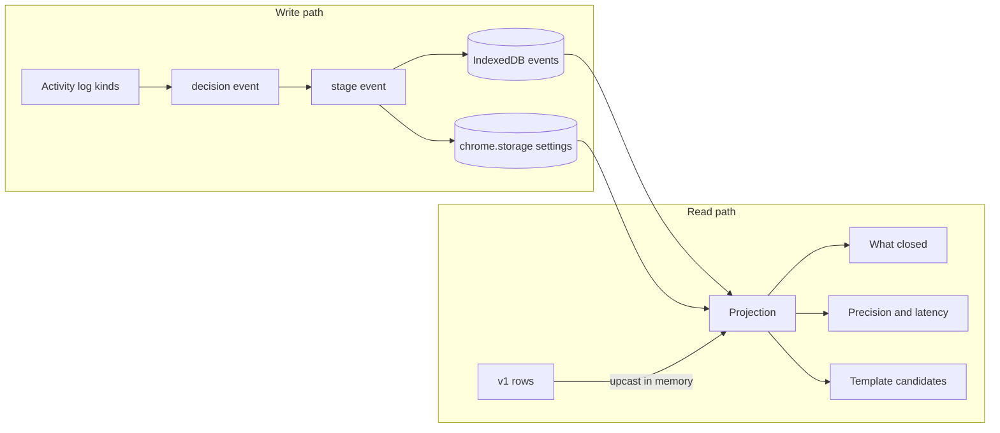

# Closed-intent ledger

Glance closes open loops. Gmail is where it starts today.

The ledger is a consented record of what got done. It stores types, not mail. Flow templates can read the same types later. Nothing in this slice leaves the device.

An event is a CloudEvents 1.0 envelope. `seq` is the per-install extension. Dedupe is `(source, id)`. A decision is written before `shown`. Later stages cite `decision_id`. An Undo does not edit the closed event. The link is the shared `decision_id`.

The first-run v1 rows stay as they were stored. A reader upcasts them in memory.

IndexedDB holds the log. chrome.storage.local holds the opt-in, the install id, the sequence cursor, and rolled counts. A daily alarm drops events older than the retention window after folding those counts.

`explore.epsilon` is 0 and the writer forces 0. The hook may vary a passive chip only when a test turns it on. It never changes an action.

The dictionary is `ledger/DATA-DICTIONARY.md`. The store definition is `ledger/DATABASE-DEFINITION.md`. The tracking plan is `ledger/tracking-plan.yaml`.
